  

  

<h3 align="center">Technologies</h3>

<table align="center" cellspacing="0" cellpadding="10">
  <tr>
    <td align="center"></td>
    <td align="center"></td>
    <td align="center"></td>
    <td align="center"></td>
    <td align="center"></td>
  </tr>
  <tr>
    <td align="center"></td>
    <td align="center"></td>
    <td align="center"></td>
   <td align="center"></td>
    <td align="center"></td>
  </tr>
  <tr>
    <td align="center"></td>
    <td align="center"></td>
    <td align="center"></td>
    <td align="center"></td>
    <td align="center"></td>
  </tr>
</table>

<h3 align="center">Vital Statistics</h3>

  

  

  
  

  

<table width="100%" border="0" cellspacing="10" cellpadding="0">
<tr>

<td width="33%" valign="top">

<h2>Collaboration</h2>

I am open to collaborating on:

<ul>
  <li>Telco data analytics</li>
  <li>Banking data analytics</li>
  <li>AI integrated development</li>
  <li>Research and papers</li>
</ul>

</td>

<td width="34%" align="center" valign="middle">
  
</td>

<td width="33%" valign="top" align="center">

<h2>Contact</h2>

 

  

  

</td>

</tr>
</table>

Building AI integrated systems and turning data into decisions

Star the repos if they helped you!

  

